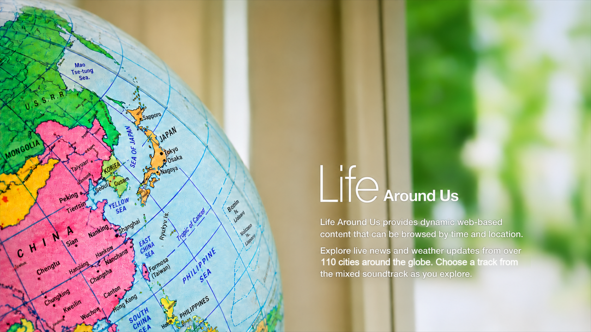
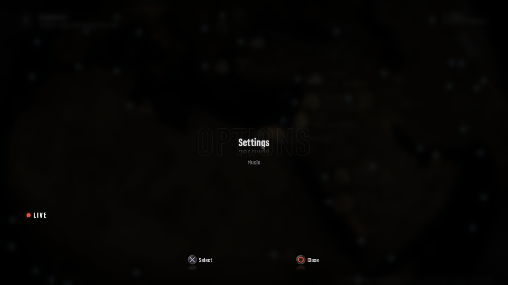
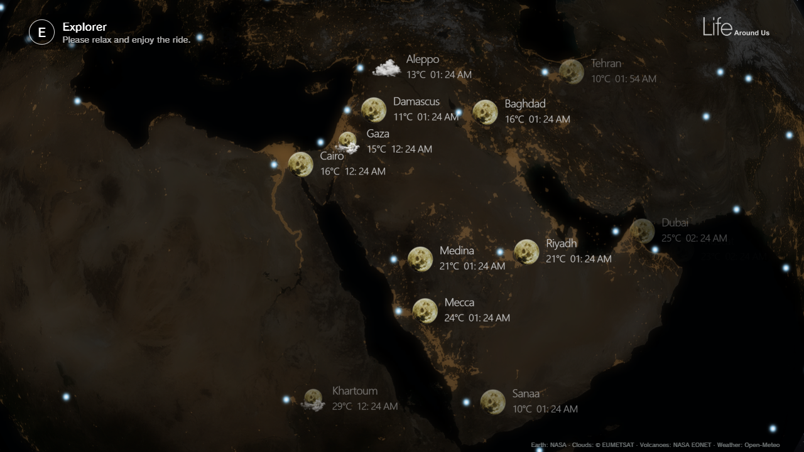
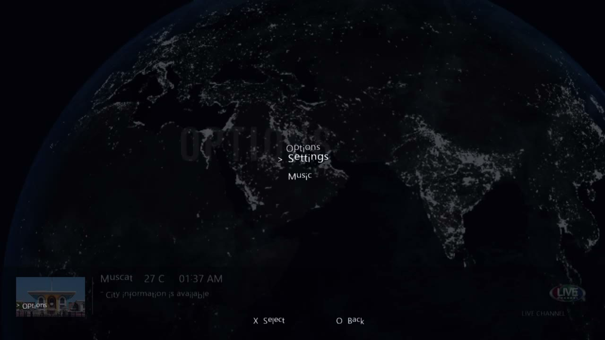

<div align="center">

# Life Around Us

### A living Earth experience across the web, consoles, Android, and Samsung TVs

**Explore the globe. Follow the world's weather and headlines. Navigate with a keyboard, gamepad, touchscreen, or TV remote.**

[](https://github.com/inevitableworry/Life-Around-Us)
[](https://life.orosapp.us/)
[](https://github.com/inevitableworry/Life-Around-Us/releases)
[](ROADMAP.md)

**[Launch the website](https://life.orosapp.us/)** ? **[Download releases](https://github.com/inevitableworry/Life-Around-Us/releases)** ? **[Platform roadmap](ROADMAP.md)** ? **[Deployment guide](docs/DEPLOYMENT.md)**

</div>

---

### See Life Around Us in motion

[](docs/media/life-site-demo.mp4)

*Captured from the running web application in a Chromium browser. The demo navigates the globe, opens Options, changes menu selection, and returns to the Earth. The animated preview is optimized for GitHub; click to view the higher-resolution MP4 recording. No artificial screenshots or pre-rendered concept art.*

<details><summary><strong>Watch or download the full demonstration</strong></summary>

[Play the browser interaction video (MP4)](docs/media/life-site-demo.mp4)

</details>

### Screenshots

| Opening experience | Interactive options |
|:---:|:---:|
|  |  |

| Globe after navigating | Native PlayStation 5 preview |
|:---:|:---:|
|  |  |

### What this project is

This repository organizes the independent Life Around Us **web experience and platform ports**. The website uses Three.js with a GitHub-backed Cloudflare Worker feed bridge, retaining weather, astronomy, and geographic visuals. Other targets have their own implementation and validation stages. The original Sony *Life with PlayStation* and the separate **Life Around Us** Windows revival are credited in [Project provenance](docs/PROVENANCE.md); this project is neither an official Sony release nor endorsed by Sony.

The cloud website deploys its web resource tree from GitHub to Cloudflare Static Assets. Some console firmware, private source dumps, external close-up tiles and development-only resources are excluded. Media and font files may carry third-party licensing obligations; publishing the repository does not grant redistribution rights.

### Build matrix

| Target | Release/preview | State | Current capability |
|---|---|---|---|
| Web | Current GitHub build | **Live on Cloudflare Worker** | Globe, interaction, edge live-feed proxy, opt-in touch controls; BEN-PC not required |
| PlayStation 5 | `PPSA99485` / v0.0001 preview | **Runs on tested console** | Native globe, city overlays, menu navigation, preview assets. Fine-text rendering is under active refinement |
| PlayStation 4 | Work-in-progress | **Source / host preview** | UI and graphics experiments; native console execution is not verified |
| PlayStation 3 | Work-in-progress | **Source / host preview** | UI scaffolding; native console execution is not verified |
| Android full client | v0.3.2 owner-local | **Locally built** | Includes separately provisioned resources; not redistributed until rights are cleared |
| Android web companion | v0.1.0 thin preview | **APK built / tablet launch observed** | Small browser-runtime package, no original media, fullscreen site, no URL bar; full rendering unverified |
| Samsung Tizen TV | v0.1.0 | **Signed WGT preview** | Small fullscreen launcher connected to the site; directional, Select, Back, and colored remote-key mapping; TV installation must be verified |

**A compiled build is not a verified hardware release.** The full acceptance matrix, specific gaps, and version-by-version work are in **[ROADMAP.md](ROADMAP.md)**.

### Controls

| Input | Default behavior |
|---|---|
| Arrow keys / directional pad | Rotate or navigate menus |
| Enter / OK | Select |
| Escape / Back | Back |
| O / Options | Show or close Options |
| Samsung TV color keys | Red/green change city, yellow/blue zoom (TV runtime) |
| Touch / drag | Rotate globe or interact directly |
| Touch overlay | **Off by default**; enable it only in Settings > Touch Controls if needed |

On Samsung TV the touch overlay stays hidden and the app opens fullscreen without an address bar.

### Repository contents

```text
web/                       Browser client, public cloud media and historical local Node backend
cloudflare/                Cloudflare Worker runtime, approved external feed proxy
platforms/
  ps5/                     Native PS5 preview source and build scripts
  ps4/                     Experimental PS4 interface source
  ps3/                     Experimental PS3 interface source
  android/                 Android client source (owner-local assets provisioned separately)
  android-web-companion/   Small public Android package with live website only
  samsung-tizen/           Lightweight Tizen TV launcher
scripts/                   Local deployment and verification helpers
docs/media/                Actual site screenshots, animated demo, video and PS5 screenshot
ROADMAP.md                 Build states, missing work, and release criteria
```

### Building and hosting

See **[Development and build notes](docs/BUILDING.md)** for toolchains and required local assets. To host the live application, see **[Cloudflare and GitHub deployment](docs/DEPLOYMENT.md)**. The site now uses a Cloudflare Worker for its allowlisted live-feed bridge. GitHub is the source of truth and triggers Cloudflare builds; Cloudflare serves the application, assets, and public hostname. BEN-PC is no longer a website production dependency.

### Credits and legal notices

This is a fan-made, independent effort. Original PlayStation software, media, names, and trademarks remain the property of their respective owners. NASA imagery, Three.js, Open-Meteo and other services are credited in **[Third-party notices](docs/THIRD_PARTY_NOTICES.md)**. Do not upload Sony firmware, original PS3 PKG archives, decompiled console executables, private tokens, or third-party media unless redistribution is authorized.

**Development status:** Public previews and research. Features, visuals, and input vary between platforms; verify each on physical hardware before depending on it.
